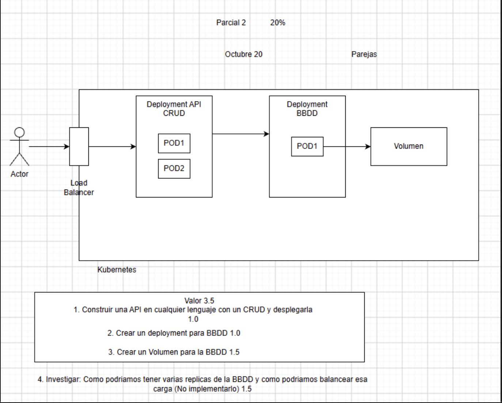
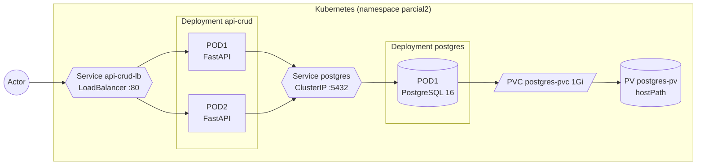
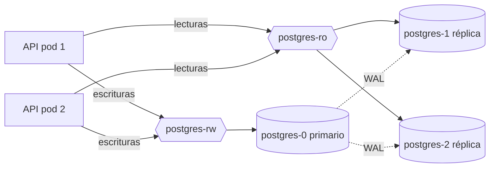

# Sistemas Distribuidos - Parcial 2

[](https://github.com/jArango82/Sistemas-distribuidos-parcial-2/actions/workflows/ci.yml)

API CRUD de productos desplegada en Kubernetes. La API corre con 2 réplicas detrás de un Service tipo LoadBalancer y guarda los datos en PostgreSQL, que a su vez usa un volumen persistente para no perder la información cuando el pod se reinicia.

Parcial 2 (20%) - 20 de octubre - en parejas.

## Enunciado



| Punto | Descripción | Valor |
|---|---|---|
| 1 | Construir una API en cualquier lenguaje con un CRUD y desplegarla | 1.0 |
| 2 | Crear un Deployment para la BBDD | 1.0 |
| 3 | Crear un Volumen para la BBDD | 1.5 |
| 4 | Investigar cómo tener varias réplicas de la BBDD y cómo balancear esa carga (sin implementarlo) | 1.5 |

## Qué hicimos en cada punto

1. **API CRUD.** La hicimos en Python con FastAPI y SQLAlchemy ([`api/`](api/)). Se despliega con un Deployment de 2 réplicas ([`k8s/20-api-deployment.yaml`](k8s/20-api-deployment.yaml)) y se expone con un Service tipo LoadBalancer ([`k8s/21-api-service.yaml`](k8s/21-api-service.yaml)), que es el load balancer del diagrama.
2. **Deployment de la BBDD.** PostgreSQL 16 con 1 réplica ([`k8s/12-postgres-deployment.yaml`](k8s/12-postgres-deployment.yaml)) y un Service interno para que la API lo encuentre por nombre ([`k8s/13-postgres-service.yaml`](k8s/13-postgres-service.yaml)).
3. **Volumen.** Un PersistentVolume ([`k8s/10-postgres-pv.yaml`](k8s/10-postgres-pv.yaml)) y un PersistentVolumeClaim ([`k8s/11-postgres-pvc.yaml`](k8s/11-postgres-pvc.yaml)) que se monta en la carpeta de datos de PostgreSQL.
4. **Investigación.** Está en [`docs/punto-4-replicas-y-balanceo-bbdd.md`](docs/punto-4-replicas-y-balanceo-bbdd.md), con un resumen [al final de este README](#punto-4-réplicas-de-la-bbdd-y-balanceo).

Además de lo que pedía el enunciado agregamos:

- Una página web en `/` para usar el CRUD y ver qué pod respondió cada petición, con un botón para probar el balanceo.
- La documentación Swagger que genera FastAPI en `/docs`.
- El header `X-Served-By` en cada respuesta con el nombre del pod. Cada producto también guarda `creado_por` y `actualizado_por`, así se ve que los dos pods escriben en la misma base de datos.
- Scripts para desplegar y probar todo, y un workflow de GitHub Actions que levanta un clúster de Kubernetes (kind) y corre las pruebas en cada push.

## Arquitectura



Cuando llega una petición, el Service `api-crud-lb` se la pasa a uno de los dos pods de la API. El pod se conecta a PostgreSQL usando el nombre `postgres` (el DNS interno de Kubernetes lo resuelve a la IP del Service) con el usuario y la contraseña que salen de un Secret. PostgreSQL guarda los datos en `/var/lib/postgresql/data`, que es donde está montado el PVC. Como el PVC está enlazado a un PV, si el pod de la base de datos se muere, el pod nuevo monta el mismo volumen y los datos siguen ahí.

## Estructura del repositorio

```
api/                  Código de la API (FastAPI), Dockerfile y pruebas
  app/main.py           endpoints
  app/models.py         tabla productos
  app/schemas.py        validaciones
  app/database.py       conexión a PostgreSQL
  app/static/           página web
k8s/                  Manifiestos de Kubernetes (se aplican en orden)
  00-namespace.yaml
  01-postgres-secret.yaml
  02-api-configmap.yaml
  10-postgres-pv.yaml
  11-postgres-pvc.yaml
  12-postgres-deployment.yaml
  13-postgres-service.yaml
  20-api-deployment.yaml
  21-api-service.yaml
scripts/              deploy.sh, pruebas y cleanup.sh
docs/                 Investigación del punto 4 y ejemplos (no se despliegan)
docker-compose.yml    Para correr la API sin Kubernetes
```

## Requisitos

- Docker
- kubectl
- Un clúster local. Nosotros usamos minikube, pero también funciona con el Kubernetes de Docker Desktop o con kind.

En Mac se puede instalar todo con Homebrew:

```bash
brew install --cask docker
```

```bash
brew install kubectl minikube
```

En Windows se pueden instalar con winget (`Docker.DockerDesktop`, `Kubernetes.kubectl` y `Kubernetes.minikube`); los scripts `.sh` se corren desde Git Bash o WSL. En Linux hay instrucciones en la página de [minikube](https://minikube.sigs.k8s.io/docs/start/).

## Cómo desplegarlo

### 1. Clonar el repositorio

```bash
git clone https://github.com/jArango82/Sistemas-distribuidos-parcial-2.git
```

```bash
cd Sistemas-distribuidos-parcial-2
```

### 2. Iniciar el clúster

```bash
minikube start --driver=docker
```

Si usan Docker Desktop, hay que activar Kubernetes en Settings > Kubernetes y después correr `kubectl config use-context docker-desktop`.

Para revisar que el nodo esté listo:

```bash
kubectl get nodes
```

### 3. Construir la imagen y desplegar

```bash
./scripts/deploy.sh
```

El script construye la imagen `parcial2-api:1.0.0` a partir de `api/Dockerfile` (en minikube la construye directamente dentro del clúster, así que no hace falta subirla a Docker Hub), aplica todos los archivos de `k8s/` y espera a que PostgreSQL y las dos réplicas de la API estén listas.

Si prefieren hacerlo a mano, es lo mismo que:

```bash
minikube image build -t parcial2-api:1.0.0 api/
kubectl apply -f k8s/
kubectl -n parcial2 rollout status deployment/postgres
kubectl -n parcial2 rollout status deployment/api-crud
```

(En Docker Desktop se cambia la primera línea por `docker build -t parcial2-api:1.0.0 api/`).

### 4. Revisar que todo esté corriendo

```bash
kubectl -n parcial2 get deploy,pods,svc,pvc
```

Debería salir algo así (esta salida es de la corrida de la CI):

```
NAME                       READY   UP-TO-DATE   AVAILABLE
deployment.apps/api-crud   2/2     2            2
deployment.apps/postgres   1/1     1            1

NAME                            READY   STATUS    RESTARTS
pod/api-crud-68bfc98bcc-fmqzl   1/1     Running   0
pod/api-crud-68bfc98bcc-xs4tp   1/1     Running   0
pod/postgres-6cf66d7685-2m6j5   1/1     Running   0

NAME                  TYPE           CLUSTER-IP      EXTERNAL-IP   PORT(S)
service/api-crud-lb   LoadBalancer   10.96.125.119   <pending>     80:30899/TCP
service/postgres      ClusterIP      10.96.224.12    <none>        5432/TCP

NAME                                 STATUS   VOLUME        CAPACITY   ACCESS MODES   STORAGECLASS
persistentvolumeclaim/postgres-pvc   Bound    postgres-pv   1Gi        RWO            manual
```

Lo importante: `api-crud` con 2/2, `postgres` con 1/1 y el PVC en estado `Bound` (quiere decir que quedó enlazado con el PV).

### 5. Entrar a la API

El Service es tipo LoadBalancer. En un clúster local no hay un balanceador de verdad, así que la `EXTERNAL-IP` queda en `<pending>` hasta que hagamos alguno de estos pasos según el clúster:

- **minikube:** en otra terminal correr `minikube tunnel` y dejarla abierta (puede pedir la contraseña del computador porque usa el puerto 80). La API queda en `http://127.0.0.1`.
- **Docker Desktop:** no hay que hacer nada, queda en `http://localhost`.
- **kind:** `kubectl -n parcial2 port-forward svc/api-crud-lb 8080:80` y la API queda en `http://localhost:8080`.

```bash
minikube tunnel
```

Con eso ya se puede abrir en el navegador:

- `http://127.0.0.1/` para la página web
- `http://127.0.0.1/docs` para Swagger

## Pruebas

En los ejemplos usamos `http://127.0.0.1`; si su URL es otra, la cambian.

### CRUD

```bash
./scripts/test-crud.sh http://127.0.0.1
```

Hace un POST, GET, PATCH, PUT, DELETE y al final un GET que tiene que dar 404, mostrando qué pod atendió cada petición. También se puede probar a mano con curl:

```bash
curl -X POST http://127.0.0.1/api/productos -H "Content-Type: application/json" -d '{"nombre":"Teclado","precio":189900,"stock":10}'
```

```bash
curl http://127.0.0.1/api/productos
```

```bash
curl -X PATCH http://127.0.0.1/api/productos/1 -H "Content-Type: application/json" -d '{"stock":5}'
```

```bash
curl -i -X DELETE http://127.0.0.1/api/productos/1
```

### Balanceo entre los dos pods

```bash
./scripts/test-balanceo.sh
```

Sin argumentos, el script crea un pod temporal dentro del clúster que hace 40 peticiones al Service y cuenta cuántas respondió cada pod. Resultado de la CI:

```
Peticiones atendidas por cada pod:
     28 api-crud-68bfc98bcc-xs4tp
     12 api-crud-68bfc98bcc-fmqzl

OK: el Service repartió la carga entre 2 pods.
```

El reparto no es exactamente la mitad porque kube-proxy elige el pod al azar en cada conexión. También se puede correr desde el computador pasando la URL (`./scripts/test-balanceo.sh http://127.0.0.1`) o con el botón "Enviar 30 peticiones" de la página.

Ojo: esta prueba no sirve con `kubectl port-forward`, porque el port-forward se conecta directo a un solo pod y no pasa por el balanceo del Service.

Si se borra uno de los dos pods de la API, el otro sigue respondiendo mientras Kubernetes crea el reemplazo:

```bash
kubectl -n parcial2 delete pod "$(kubectl -n parcial2 get pod -l app=api-crud -o jsonpath='{.items[0].metadata.name}')"
```

### Persistencia del volumen

```bash
./scripts/test-persistencia.sh
```

Inserta un registro directamente en PostgreSQL, borra el pod de la base de datos, espera a que Kubernetes cree uno nuevo y busca el registro desde ese pod nuevo. Resultado de la CI:

```
[1/3] Pod actual de la BBDD: postgres-6cf66d7685-2m6j5
      Insertado el producto 'persistencia-1792459452'
[2/3] Eliminando el pod postgres-6cf66d7685-2m6j5 ...
      Pod nuevo de la BBDD: postgres-6cf66d7685-4jbmf
[3/3] Buscando el producto en el pod nuevo...
OK: el dato sigue ahí después de borrar el pod, el volumen funciona.
```

Para mostrarlo sin el script: crear algunos productos en la página, borrar el pod de PostgreSQL con el comando de abajo y recargar la página. Los productos siguen.

```bash
kubectl -n parcial2 delete pod -l app=postgres
```

En minikube se puede ver dónde quedan los archivos de PostgreSQL dentro del nodo:

```bash
minikube ssh -- sudo ls /data/parcial2-postgres/pgdata
```

### Borrar todo

```bash
./scripts/cleanup.sh
```

Como el PV tiene `persistentVolumeReclaimPolicy: Retain`, los archivos de la base de datos se quedan en el nodo aunque se borre todo. Si se vuelve a desplegar, los productos aparecen otra vez. Para borrarlos del todo en minikube: `minikube ssh -- sudo rm -rf /data/parcial2-postgres`.

### Sin Kubernetes

Para trabajar en la API sin el clúster se puede usar Docker Compose (queda en `http://localhost:8000`):

```bash
docker compose up --build
```

Y las pruebas unitarias se corren con `pip install -r requirements-dev.txt` y `pytest` dentro de `api/`.

## Endpoints

| Método | Ruta | Qué hace |
|---|---|---|
| POST | `/api/productos` | Crea un producto (201) |
| GET | `/api/productos` | Lista productos. Acepta `q` para buscar, `limit` y `offset` |
| GET | `/api/productos/{id}` | Trae un producto (404 si no existe) |
| PUT | `/api/productos/{id}` | Reemplaza todos los campos |
| PATCH | `/api/productos/{id}` | Cambia solo los campos que se envían |
| DELETE | `/api/productos/{id}` | Borra el producto (204) |
| GET | `/api/info` | Nombre, IP y nodo del pod que respondió |
| GET | `/health` | Lo usa la liveness probe |
| GET | `/ready` | Lo usa la readiness probe, revisa la conexión a PostgreSQL |

Un producto tiene esta forma:

```json
{
  "id": 1,
  "nombre": "Teclado mecánico",
  "descripcion": "Switches rojos",
  "precio": 189900,
  "stock": 10,
  "creado_por": "api-crud-68bfc98bcc-xs4tp",
  "actualizado_por": "api-crud-68bfc98bcc-fmqzl",
  "creado_en": "2026-10-20T14:03:11Z",
  "actualizado_en": "2026-10-20T14:05:42Z"
}
```

`nombre` es obligatorio (máximo 120 caracteres) y `precio` y `stock` no pueden ser negativos. Si algo no cumple, la API responde 422.

## Detalles de los manifiestos

**Namespace (`00`).** Todo queda en el namespace `parcial2`, así se puede ver con `kubectl -n parcial2 get all` y borrar junto.

**Secret (`01`).** Tiene el usuario, la contraseña y el nombre de la base de datos. PostgreSQL los recibe como `POSTGRES_USER`, `POSTGRES_PASSWORD` y `POSTGRES_DB`, y la API como `DB_USER`, `DB_PASSWORD` y `DB_NAME`. Usamos `stringData` para escribirlos en texto plano (Kubernetes los guarda en base64). Lo dejamos en el repo porque es un trabajo académico; en un proyecto real no se subiría.

**ConfigMap (`02`).** Configuración de la API que no es secreta. `DB_HOST` vale `postgres`, que es el nombre del Service de la base de datos.

**PersistentVolume (`10`).** Es el almacenamiento. Usamos `hostPath`, que es una carpeta dentro del nodo (`/data/parcial2-postgres`), de 1Gi y con modo `ReadWriteOnce`. Le pusimos `Retain` para que los datos no se borren si alguien borra el PVC. `hostPath` sirve para clústeres de un solo nodo como minikube; en la nube se usaría un StorageClass que cree el disco automáticamente.

**PersistentVolumeClaim (`11`).** Es la solicitud de almacenamiento que hace el pod de PostgreSQL: pide 1Gi, `ReadWriteOnce` y la clase `manual`. Kubernetes lo enlaza con el PV que cumpla esas condiciones. La idea de separar PV y PVC es que el Deployment no tenga que saber de dónde sale el disco.

**Deployment de PostgreSQL (`12`).** Una réplica de `postgres:16-alpine` que monta el PVC en `/var/lib/postgresql/data`. Usa `strategy: Recreate` para que al actualizar primero se apague el pod viejo y después arranque el nuevo; con `RollingUpdate` habría por un momento dos PostgreSQL escribiendo en la misma carpeta. Las probes usan `pg_isready`.

**Service de PostgreSQL (`13`).** Tipo `ClusterIP`, o sea que solo se puede usar desde dentro del clúster. Le da a la base de datos un nombre fijo (`postgres`) aunque el pod cambie de IP.

**Deployment de la API (`20`).** Dos réplicas. Tiene un initContainer que espera a que PostgreSQL acepte conexiones antes de arrancar la API. Con la Downward API cada pod recibe su propio nombre, IP y nodo, que es lo que devuelve en `X-Served-By` y en `/api/info`. Tiene tres probes:

- `startupProbe` le da hasta 60 segundos para arrancar.
- `livenessProbe` (`/health`): si falla, Kubernetes reinicia el contenedor.
- `readinessProbe` (`/ready`): si falla (por ejemplo porque se cayó la base de datos), el pod deja de recibir tráfico pero no se reinicia.

La actualización es `RollingUpdate` con `maxUnavailable: 0`, para que siempre haya al menos 2 pods disponibles. El contenedor corre con un usuario que no es root.

**Service de la API (`21`).** Tipo `LoadBalancer`, puerto 80 hacia el 8000 del contenedor. Reparte el tráfico entre los pods con la etiqueta `app=api-crud` que estén listos. Un detalle: kube-proxy reparte por conexión TCP, no por petición, así que si el navegador reutiliza la conexión todas las peticiones caen en el mismo pod. Por eso la API responde con `Connection: close` en las rutas `/api/`, para que en la demo se vea el reparto. En producción no se haría.

## Punto 4: réplicas de la BBDD y balanceo

El documento completo está en [`docs/punto-4-replicas-y-balanceo-bbdd.md`](docs/punto-4-replicas-y-balanceo-bbdd.md). En resumen:

No sirve con cambiar `replicas: 1` por `replicas: 3` en el Deployment de PostgreSQL. Los tres pods montarían el mismo volumen y escribirían en la misma carpeta, lo que corrompe los datos. Y si cada uno tuviera su propio volumen, serían tres bases de datos distintas, cada una con datos diferentes. La diferencia con la API es que la API no guarda estado y cualquier réplica responde igual, mientras que la base de datos sí guarda estado y las réplicas tienen que estar sincronizadas.

Lo que se usa en Kubernetes es un **StatefulSet**: los pods tienen nombres fijos (`postgres-0`, `postgres-1`, `postgres-2`), cada uno tiene su propio PVC y cada uno tiene su propio DNS a través de un Service headless.

Encima de eso se configura la **replicación de PostgreSQL** (streaming replication). Un nodo es el primario y es el único que acepta escrituras; los demás son réplicas que reciben los cambios del primario (el WAL) y solo atienden lecturas. La replicación puede ser asíncrona, que es más rápida pero puede perder las últimas transacciones si el primario se cae, o síncrona, que no pierde datos pero hace más lentas las escrituras.

Como PostgreSQL no cambia de primario solo cuando el primario se cae, se necesita algo que haga el **failover**: Patroni o un operador como CloudNativePG, que detectan la caída y promueven una réplica.

Para **balancear la carga**, las escrituras tienen que ir al primario y las lecturas se pueden repartir entre las réplicas. Hay varias formas:

- Dos Services: `postgres-rw`, que apunta solo al primario, y `postgres-ro`, que reparte entre las réplicas. CloudNativePG los crea solo.
- Un proxy que entiende SQL, como Pgpool-II (manda los SELECT a las réplicas automáticamente) o HAProxy con los health checks de Patroni. PgBouncer sirve para manejar el pool de conexiones.
- Desde la aplicación, con una conexión para escribir y otra para leer, o con cadenas de conexión de libpq con varios hosts (`target_session_attrs`, `load_balance_hosts`).

También existen bases de datos que escalan las escrituras, no solo las lecturas: multi-primario (Galera), sharding (Citus, Vitess) y bases de datos distribuidas como CockroachDB o YugabyteDB. El costo de replicar es el replication lag (una lectura en una réplica puede no ver todavía lo que se acaba de escribir) y lo que dicen los teoremas CAP y PACELC sobre consistencia, disponibilidad y latencia.

Para este proyecto, lo que haríamos es instalar CloudNativePG, cambiar los manifiestos `10` a `13` por un recurso `Cluster` con 3 instancias (1 primario y 2 réplicas, una de ellas síncrona) y hacer que la API use `postgres-rw` para escribir y `postgres-ro` para leer:



Dejamos un ejemplo de cómo se vería en [`docs/ejemplos-no-implementados/`](docs/ejemplos-no-implementados/), pero no se aplica porque el punto pide solo investigar.

## Problemas comunes

- **El pod de la API queda en `ErrImagePull` o `ImagePullBackOff`:** la imagen no está dentro del clúster. Hay que volver a correr `./scripts/deploy.sh`.
- **`EXTERNAL-IP` se queda en `<pending>`:** en minikube falta dejar corriendo `minikube tunnel`.
- **El pod de la API se queda en `Init:0/1`:** está esperando a PostgreSQL. Revisar con `kubectl -n parcial2 logs deploy/postgres`.
- **El PVC queda en `Pending`:** si el PV quedó en estado `Released` de un despliegue anterior, hay que borrarlo (`kubectl delete pv postgres-pv`) y desplegar otra vez.
- **El balanceo muestra un solo pod:** revisar que los dos pods estén `Running` y no usar `port-forward` para esa prueba.

Para ver los logs de la API o consultar la base de datos directamente:

```bash
kubectl -n parcial2 logs -f -l app=api-crud --prefix
```

```bash
kubectl -n parcial2 exec -it deploy/postgres -- psql -U parcial2 -d inventario -c "SELECT id, nombre, creado_por FROM productos;"
```

## Integrantes

- Juan Manuel Arango Bedoya ([@jArango82](https://github.com/jArango82))
- (pendiente)
