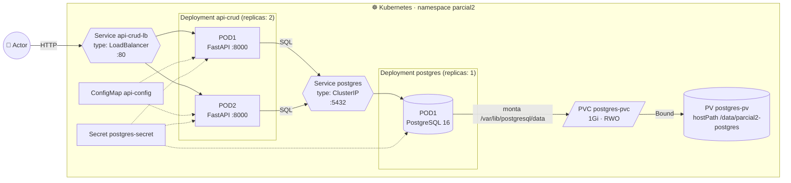
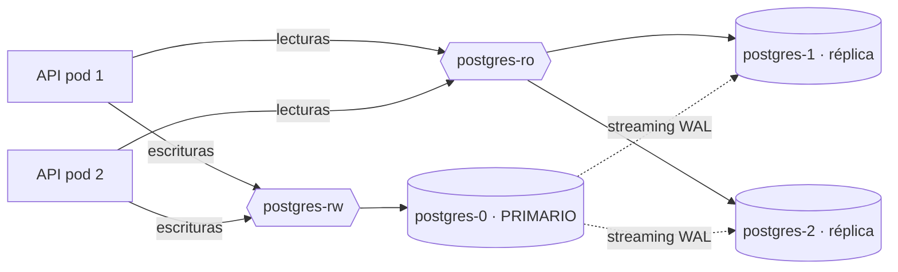

<div align="center">

# ☸️ Sistemas Distribuidos · Parcial 2

**API CRUD desplegada en Kubernetes con balanceador de carga, PostgreSQL y volumen persistente**

[](https://github.com/jArango82/Sistemas-distribuidos-parcial-2/actions/workflows/ci.yml)


Parcial 2 · 20 % · 20 de octubre · En parejas

</div>

---

## 📑 Contenido

1. [El enunciado](#-el-enunciado)
2. [Cómo se cumple cada punto](#-cómo-se-cumple-cada-punto)
3. [Arquitectura](#️-arquitectura)
4. [Estructura del repositorio](#-estructura-del-repositorio)
5. [Requisitos](#-requisitos)
6. [**Paso a paso: desplegar y probar**](#-paso-a-paso-desplegar-y-probar) ← empieza aquí
7. [Endpoints de la API](#-endpoints-de-la-api)
8. [Explicación de cada manifiesto](#-explicación-de-cada-manifiesto)
9. [Punto 4: réplicas y balanceo de la BBDD](#-punto-4-réplicas-y-balanceo-de-la-bbdd)
10. [Guion para la sustentación](#-guion-para-la-sustentación-5-minutos)
11. [Preguntas que puede hacer el profe](#-preguntas-que-puede-hacer-el-profe)
12. [Solución de problemas](#-solución-de-problemas)
13. [Pruebas automáticas (CI)](#-pruebas-automáticas-ci)
14. [Integrantes](#-integrantes)

---

## 📋 El enunciado

<details>
<summary>Ver el diagrama original del parcial</summary>


</details>

Hay que montar esta arquitectura dentro de **Kubernetes**:

```
Actor ──▶ Load Balancer ──▶ Deployment API CRUD ──▶ Deployment BBDD ──▶ Volumen
                              ├─ POD1                  └─ POD1
                              └─ POD2
```

| # | Punto | Valor |
|:-:|---|:-:|
| 1 | Construir una **API en cualquier lenguaje con un CRUD** y desplegarla | 1.0 |
| 2 | Crear un **Deployment para la BBDD** | 1.0 |
| 3 | Crear un **Volumen para la BBDD** | 1.5 |
| | *Subtotal implementación* | *3.5* |
| 4 | **Investigar:** cómo tener varias réplicas de la BBDD y cómo balancear esa carga (**no implementarlo**) | 1.5 |
| | **Total** | **5.0** |

---

## ✅ Cómo se cumple cada punto

| # | Lo que pide | Dónde está | Cómo se demuestra |
|:-:|---|---|---|
| 1 | API con CRUD desplegada | [`api/`](api/) (Python + FastAPI) · [`k8s/20-api-deployment.yaml`](k8s/20-api-deployment.yaml) (**2 pods**) · [`k8s/21-api-service.yaml`](k8s/21-api-service.yaml) (**LoadBalancer**) | `./scripts/test-crud.sh` y `./scripts/test-balanceo.sh` |
| 2 | Deployment de la BBDD | [`k8s/12-postgres-deployment.yaml`](k8s/12-postgres-deployment.yaml) (PostgreSQL 16, **1 pod**) · [`k8s/13-postgres-service.yaml`](k8s/13-postgres-service.yaml) | `kubectl -n parcial2 get deploy postgres` |
| 3 | Volumen para la BBDD | [`k8s/10-postgres-pv.yaml`](k8s/10-postgres-pv.yaml) (**PersistentVolume**) · [`k8s/11-postgres-pvc.yaml`](k8s/11-postgres-pvc.yaml) (**PersistentVolumeClaim**) | `./scripts/test-persistencia.sh` (mata el pod de la BBDD y los datos siguen ahí) |
| 4 | Investigación réplicas + balanceo | [`docs/punto-4-replicas-y-balanceo-bbdd.md`](docs/punto-4-replicas-y-balanceo-bbdd.md) · ejemplos en [`docs/ejemplos-no-implementados/`](docs/ejemplos-no-implementados/) | [Resumen más abajo](#-punto-4-réplicas-y-balanceo-de-la-bbdd) |

**Extras** que suman en la sustentación:

- 🖥️ **Interfaz web** en `/` que muestra en vivo **qué pod atendió cada petición** y una prueba de balanceo con gráfica.
- 📘 **Swagger** automático en `/docs` para probar el CRUD desde el navegador.
- 🏷️ Cada respuesta trae el header **`X-Served-By`** con el nombre del pod, y cada producto guarda `creado_por` / `actualizado_por` → se ve que **los 2 pods comparten la misma BBDD**.
- ❤️ **Probes** de liveness, readiness y startup; **initContainer** que espera a PostgreSQL; **Secret** y **ConfigMap**; límites de CPU/memoria; contenedor sin root.
- 🤖 **CI en GitHub Actions** que levanta un Kubernetes real (kind), despliega todo y prueba CRUD, balanceo y persistencia en cada push.

---

## 🏗️ Arquitectura



**Flujo de una petición** (por ejemplo `POST /api/productos`):

1. El **actor** (navegador, `curl`, Postman) llama al **Service `api-crud-lb`** (tipo `LoadBalancer`).
2. El Service elige uno de los **2 pods** de la API que estén *Ready* y le pasa la conexión.
3. El pod se conecta a PostgreSQL usando el nombre DNS **`postgres`** (el Service interno de la BBDD) con las credenciales del **Secret**.
4. PostgreSQL guarda los datos en `/var/lib/postgresql/data`, que es el **PVC**, enlazado al **PV** (una carpeta en el nodo). Si el pod de la BBDD muere, el nuevo pod monta el mismo volumen y **no se pierde nada**.

| Componente | Tecnología | Por qué |
|---|---|---|
| API | **Python 3.12 + FastAPI + SQLAlchemy** | CRUD en pocas líneas, validación automática y Swagger gratis |
| BBDD | **PostgreSQL 16 (alpine)** | Relacional, robusta, imagen oficial liviana |
| Contenedores | **Docker** | La imagen de la API se construye con [`api/Dockerfile`](api/Dockerfile) |
| Orquestador | **Kubernetes** (minikube, Docker Desktop o kind) | Lo pide el parcial |

---

## 📁 Estructura del repositorio

```
.
├── api/                              # PUNTO 1 · la API CRUD
│   ├── app/
│   │   ├── main.py                   #   endpoints CRUD + health/ready/info
│   │   ├── models.py                 #   tabla "productos" (SQLAlchemy)
│   │   ├── schemas.py                #   validación de datos (Pydantic)
│   │   ├── database.py               #   conexión a PostgreSQL (lee variables de entorno)
│   │   └── static/index.html         #   interfaz web
│   ├── tests/                        #   pruebas unitarias (pytest)
│   ├── Dockerfile                    #   imagen de la API
│   └── requirements.txt
├── k8s/                              # Manifiestos (se aplican en orden numérico)
│   ├── 00-namespace.yaml
│   ├── 01-postgres-secret.yaml       #   credenciales de la BBDD
│   ├── 02-api-configmap.yaml         #   configuración de la API
│   ├── 10-postgres-pv.yaml           # PUNTO 3 · PersistentVolume
│   ├── 11-postgres-pvc.yaml          # PUNTO 3 · PersistentVolumeClaim
│   ├── 12-postgres-deployment.yaml   # PUNTO 2 · Deployment BBDD (1 pod)
│   ├── 13-postgres-service.yaml      #   Service interno de la BBDD
│   ├── 20-api-deployment.yaml        # PUNTO 1 · Deployment API (2 pods)
│   └── 21-api-service.yaml           # PUNTO 1 · Load Balancer
├── scripts/
│   ├── deploy.sh                     # construye la imagen y despliega todo
│   ├── test-crud.sh                  # prueba Create/Read/Update/Delete
│   ├── test-balanceo.sh              # muestra el reparto entre los 2 pods
│   ├── test-persistencia.sh          # mata la BBDD y comprueba que los datos siguen
│   └── cleanup.sh                    # borra todo
├── docs/
│   ├── punto-4-replicas-y-balanceo-bbdd.md   # PUNTO 4 · investigación completa
│   └── ejemplos-no-implementados/            # YAML ilustrativos del punto 4 (no se aplican)
├── docker-compose.yml                # correr la API sin Kubernetes (opcional)
└── .github/workflows/ci.yml          # CI: pruebas + despliegue real en kind
```

---

## 🧰 Requisitos

Necesitas **Docker**, **kubectl** y **un clúster de Kubernetes local**. Elige UNA opción de clúster:

| Opción | Recomendado para | Instalación |
|---|---|---|
| **minikube** ⭐ | Cualquier sistema operativo | <https://minikube.sigs.k8s.io/docs/start/> |
| **Docker Desktop** | Mac / Windows (el más fácil) | Settings → Kubernetes → *Enable Kubernetes* |
| **kind** | Linux / CI | <https://kind.sigs.k8s.io/> |

<details>
<summary><b>macOS</b> (Homebrew)</summary>

```bash
brew install --cask docker
```

```bash
brew install kubectl minikube
```
</details>

<details>
<summary><b>Windows</b> (PowerShell como administrador)</summary>

```powershell
winget install Docker.DockerDesktop
winget install Kubernetes.kubectl
winget install Kubernetes.minikube
```

> Los scripts `.sh` se corren desde **Git Bash** o **WSL**. Si no, puedes ejecutar a mano los comandos `kubectl` que aparecen en esta guía.
</details>

<details>
<summary><b>Linux</b></summary>

Docker: <https://docs.docker.com/engine/install/> · kubectl: <https://kubernetes.io/docs/tasks/tools/> · minikube:

```bash
curl -LO https://storage.googleapis.com/minikube/releases/latest/minikube-linux-amd64 && sudo install minikube-linux-amd64 /usr/local/bin/minikube
```
</details>

Comprueba que todo responde:

```bash
docker version && kubectl version --client && minikube version
```

---

## 🚀 Paso a paso: desplegar y probar

### Paso 0 · Clonar el repositorio

```bash
git clone https://github.com/jArango82/Sistemas-distribuidos-parcial-2.git
```

```bash
cd Sistemas-distribuidos-parcial-2
```

### Paso 1 · Encender el clúster

**Con minikube:**

```bash
minikube start --driver=docker --cpus=2 --memory=4096
```

**Con Docker Desktop:** activa Kubernetes en *Settings → Kubernetes* y selecciona el contexto:

```bash
kubectl config use-context docker-desktop
```

Verifica que el nodo está `Ready`:

```bash
kubectl get nodes
```

### Paso 2 · Construir la imagen y desplegar TODO

Un solo comando:

```bash
./scripts/deploy.sh
```

El script detecta tu clúster y hace esto:

1. **Construye la imagen** `parcial2-api:1.0.0` desde `api/Dockerfile` (en minikube la construye *dentro* del clúster, así no se necesita Docker Hub).
2. Aplica **todos los manifiestos** de `k8s/` en orden: namespace → secret/configmap → PV → PVC → PostgreSQL → API.
3. **Espera** a que PostgreSQL y las 2 réplicas de la API estén listas.

<details>
<summary>¿Prefieres hacerlo a mano? (mismo resultado)</summary>

```bash
minikube image build -t parcial2-api:1.0.0 api/      # minikube
# docker build -t parcial2-api:1.0.0 api/           # Docker Desktop
kubectl apply -f k8s/
kubectl -n parcial2 rollout status deployment/postgres
kubectl -n parcial2 rollout status deployment/api-crud
```
</details>

### Paso 3 · Verificar que todo está arriba

```bash
kubectl -n parcial2 get deploy,pods,svc,pvc -o wide
```

Debes ver algo así:

```
NAME                       READY   UP-TO-DATE   AVAILABLE
deployment.apps/api-crud   2/2     2            2           ← PUNTO 1: 2 pods de la API
deployment.apps/postgres   1/1     1            1           ← PUNTO 2: 1 pod de la BBDD

NAME                            READY   STATUS    
pod/api-crud-6d5f7c9b8-4xk2p    1/1     Running   ← POD1
pod/api-crud-6d5f7c9b8-r7m9t    1/1     Running   ← POD2
pod/postgres-5b8c6d7f9-zq8wn    1/1     Running   ← POD1 BBDD

NAME                  TYPE           CLUSTER-IP      EXTERNAL-IP   PORT(S)
service/api-crud-lb   LoadBalancer   10.96.120.15    127.0.0.1     80:31234/TCP   ← Load Balancer
service/postgres      ClusterIP      10.96.45.200    <none>        5432/TCP

NAME                                 STATUS   VOLUME        CAPACITY   ACCESS MODES   STORAGECLASS
persistentvolumeclaim/postgres-pvc   Bound    postgres-pv   1Gi        RWO            manual   ← PUNTO 3
```

> El PVC debe estar en **`Bound`**: significa que se enlazó con el PV.

### Paso 4 · Acceder a la API desde fuera del clúster

El Service es tipo **LoadBalancer**. Cómo obtener su dirección depende del clúster:

| Clúster | Qué hacer | URL de la API |
|---|---|---|
| **Docker Desktop** | Nada, ya queda expuesto | <http://localhost> |
| **minikube** | En **otra terminal** deja corriendo `minikube tunnel` (puede pedir tu contraseña porque usa el puerto 80) | <http://127.0.0.1> (mira `EXTERNAL-IP`) |
| **minikube** (alternativa) | `minikube service api-crud-lb -n parcial2 --url` y usa la URL que imprime | la que imprime |
| **kind** | `kubectl -n parcial2 port-forward svc/api-crud-lb 8080:80` | <http://localhost:8080> |

Para minikube:

```bash
minikube tunnel
```

Y comprueba la `EXTERNAL-IP` en otra terminal:

```bash
kubectl -n parcial2 get svc api-crud-lb
```

Abre en el navegador:

- **`http://<EXTERNAL-IP>/`** → interfaz web (crear, editar, borrar productos y ver qué pod responde).
- **`http://<EXTERNAL-IP>/docs`** → Swagger para probar cada endpoint.

### Paso 5 · Probar el CRUD (punto 1)

```bash
./scripts/test-crud.sh http://localhost
```

> Cambia `http://localhost` por la URL del paso 4. El script hace **POST → GET → PATCH → PUT → DELETE → GET (404)** y muestra qué pod atendió cada petición.

O a mano con `curl`:

```bash
curl -X POST http://localhost/api/productos -H "Content-Type: application/json" -d '{"nombre":"Teclado","precio":189900,"stock":10}'
```

```bash
curl http://localhost/api/productos
```

```bash
curl -X PATCH http://localhost/api/productos/1 -H "Content-Type: application/json" -d '{"stock":5}'
```

```bash
curl -X DELETE http://localhost/api/productos/1 -i
```

### Paso 6 · Demostrar el balanceo entre POD1 y POD2 (punto 1)

```bash
./scripts/test-balanceo.sh
```

Sin argumentos lanza un pod temporal **dentro** del clúster que hace 40 peticiones al Service y cuenta quién respondió:

```
Peticiones atendidas por cada pod:
     22 api-crud-6d5f7c9b8-4xk2p
     18 api-crud-6d5f7c9b8-r7m9t

✅ El Service repartió la carga entre 2 pods.
```

También puedes hacerlo desde tu máquina pasando la URL del Load Balancer (`./scripts/test-balanceo.sh http://localhost`) o con el botón **"Enviar 30 peticiones"** de la interfaz web.

> ⚠️ No uses `kubectl port-forward` para esta prueba: el port-forward se conecta a **un solo pod** y no pasa por el balanceo.

Prueba extra de **tolerancia a fallos**: borra **uno** de los pods de la API y mira cómo Kubernetes crea otro mientras el servicio sigue respondiendo con el pod que queda:

```bash
kubectl -n parcial2 delete pod "$(kubectl -n parcial2 get pod -l app=api-crud -o jsonpath='{.items[0].metadata.name}')" --wait=false
```

```bash
kubectl -n parcial2 get pods -w
```

### Paso 7 · Demostrar que el volumen funciona (punto 3)

```bash
./scripts/test-persistencia.sh
```

```
1️⃣  Pod actual de la BBDD: postgres-5b8c6d7f9-zq8wn
    Insertado el producto 'persistencia-1760918400'
2️⃣  Eliminando el pod postgres-5b8c6d7f9-zq8wn ...
    Pod nuevo de la BBDD: postgres-5b8c6d7f9-h2v6c
3️⃣  Buscando el producto en el pod nuevo...
✅ El dato sobrevivió a la muerte del pod: el volumen funciona.
```

Para verlo "a mano" en la sustentación: crea productos en la interfaz web → borra el pod de PostgreSQL → recarga la página: **los productos siguen ahí**.

```bash
kubectl -n parcial2 delete pod -l app=postgres
```

Ver dónde quedan físicamente los datos dentro del nodo (minikube):

```bash
minikube ssh -- sudo ls /data/parcial2-postgres/pgdata
```

### Paso 8 · Limpiar

```bash
./scripts/cleanup.sh
```

> Por la política `Retain` del PV, los archivos de la BBDD siguen en el nodo: si vuelves a desplegar, los productos reaparecen. Para borrarlos del todo: `minikube ssh -- sudo rm -rf /data/parcial2-postgres`.

<details>
<summary>🐳 Opcional: correr la API sin Kubernetes (docker compose)</summary>

Útil para desarrollar rápido:

```bash
docker compose up --build
```

Queda en <http://localhost:8000>. Para correr las pruebas unitarias:

```bash
cd api && pip install -r requirements-dev.txt && pytest -q
```
</details>

---

## 🔌 Endpoints de la API

Base: `http://<EXTERNAL-IP>` · Documentación interactiva: **`/docs`**

| Método | Ruta | Descripción | Respuesta |
|---|---|---|---|
| `POST` | `/api/productos` | **C**rear un producto | `201` + producto |
| `GET` | `/api/productos?q=&limit=&offset=` | **R**ead: listar (con búsqueda y paginación) | `200` + lista |
| `GET` | `/api/productos/{id}` | **R**ead de uno | `200` / `404` |
| `PUT` | `/api/productos/{id}` | **U**pdate completo | `200` / `404` |
| `PATCH` | `/api/productos/{id}` | **U**pdate parcial | `200` / `404` |
| `DELETE` | `/api/productos/{id}` | **D**elete | `204` / `404` |
| `GET` | `/api/info` | Pod, IP, nodo y nº de productos | `200` |
| `GET` | `/health` | *Liveness*: el proceso vive | `200` |
| `GET` | `/ready` | *Readiness*: hay conexión con PostgreSQL | `200` / `503` |
| `GET` | `/` | Interfaz web | HTML |

Modelo **Producto**:

```json
{
  "id": 1,
  "nombre": "Teclado mecánico",
  "descripcion": "Switches rojos",
  "precio": 189900,
  "stock": 10,
  "creado_por": "api-crud-6d5f7c9b8-4xk2p",
  "actualizado_por": "api-crud-6d5f7c9b8-r7m9t",
  "creado_en": "2026-10-20T14:03:11Z",
  "actualizado_en": "2026-10-20T14:05:42Z"
}
```

Validaciones: `nombre` obligatorio (1–120 caracteres), `precio ≥ 0`, `stock ≥ 0`. Si no se cumplen → `422`.

---

## 🔍 Explicación de cada manifiesto

<details open>
<summary><b>00 · Namespace</b> — <code>parcial2</code></summary>

Agrupa todos los recursos. Permite ver todo con `kubectl -n parcial2 get all` y borrarlo junto.
</details>

<details>
<summary><b>01 · Secret</b> — credenciales de PostgreSQL</summary>

- `POSTGRES_USER`, `POSTGRES_PASSWORD`, `POSTGRES_DB`.
- PostgreSQL las lee con `envFrom.secretRef`; la API las recibe como `DB_USER`, `DB_PASSWORD`, `DB_NAME` con `secretKeyRef`.
- `stringData` deja escribirlas en texto plano; Kubernetes las guarda en base64. En un proyecto real **no** se suben al repo (se usan Sealed Secrets, External Secrets, Vault…).
</details>

<details>
<summary><b>02 · ConfigMap</b> — configuración de la API</summary>

`DB_HOST: postgres` es el **nombre del Service** de la BBDD. El DNS interno de Kubernetes (CoreDNS) lo resuelve a `postgres.parcial2.svc.cluster.local`, así la API nunca depende de la IP de un pod.
</details>

<details>
<summary><b>10 · PersistentVolume</b> — el "disco" (punto 3)</summary>

| Campo | Valor | Significado |
|---|---|---|
| `capacity.storage` | `1Gi` | Tamaño |
| `accessModes` | `ReadWriteOnce` | Lo monta **un nodo** en lectura/escritura |
| `persistentVolumeReclaimPolicy` | `Retain` | Si se borra el PVC, **los datos se conservan** (con `Delete` se borrarían) |
| `storageClassName` | `manual` | Etiqueta para que solo lo reclame nuestro PVC |
| `hostPath.path` | `/data/parcial2-postgres` | Carpeta real dentro del nodo |

`hostPath` es ideal para clústeres locales de un nodo. En la nube se usaría un StorageClass (discos EBS, Persistent Disk, Azure Disk…) y el PV se crearía solo (*aprovisionamiento dinámico*).
</details>

<details>
<summary><b>11 · PersistentVolumeClaim</b> — la "solicitud" de disco (punto 3)</summary>

El pod no pide un PV concreto: pide "**1Gi, ReadWriteOnce, clase manual**" y Kubernetes lo enlaza (`Bound`) con un PV que cumpla. Esto **desacopla** la aplicación de la infraestructura: el mismo Deployment funciona con hostPath, NFS o un disco en la nube.

```
Pod ──usa──▶ PVC (postgres-pvc) ──Bound──▶ PV (postgres-pv) ──▶ /data/parcial2-postgres en el nodo
```
</details>

<details>
<summary><b>12 · Deployment de PostgreSQL</b> (punto 2)</summary>

- `replicas: 1` → el POD1 del diagrama.
- `strategy: Recreate` → al actualizar, primero muere el pod viejo y luego nace el nuevo. Con `RollingUpdate` habría **dos PostgreSQL sobre la misma carpeta** al mismo tiempo (corrupción).
- `volumeMounts` monta el PVC en `/var/lib/postgresql/data`, y `PGDATA` apunta a una subcarpeta `pgdata`.
- `readinessProbe` / `livenessProbe` con `pg_isready -h 127.0.0.1`: el pod solo recibe tráfico cuando PostgreSQL acepta conexiones TCP.
- `resources` → reserva y limita CPU/memoria.
</details>

<details>
<summary><b>13 · Service de PostgreSQL</b> — ClusterIP</summary>

Nombre DNS fijo (`postgres`) e IP virtual estable para la BBDD. Es **`ClusterIP`**: solo accesible **dentro** del clúster (la BBDD no debe exponerse a Internet).
</details>

<details>
<summary><b>20 · Deployment de la API</b> (punto 1)</summary>

- `replicas: 2` → POD1 y POD2 del diagrama.
- `RollingUpdate` con `maxUnavailable: 0`: al actualizar la imagen nunca baja de 2 pods disponibles (cero caída).
- `initContainers.esperar-postgres`: no arranca la API hasta que PostgreSQL responda.
- **Downward API** (`POD_NAME`, `POD_IP`, `NODE_NAME`): el pod conoce su propio nombre y lo devuelve en `X-Served-By`.
- Tres probes:
  - `startupProbe` → le da hasta 60 s para arrancar.
  - `livenessProbe` (`/health`) → si falla, **reinicia** el contenedor.
  - `readinessProbe` (`/ready`) → si falla (p. ej. se cayó la BBDD), **lo saca del balanceador** sin reiniciarlo.
- `securityContext` → corre sin root.
</details>

<details>
<summary><b>21 · Service LoadBalancer</b> (punto 1, el "Load Balancer" del diagrama)</summary>

- `type: LoadBalancer` → pide una IP externa al proveedor (en la nube crea un balanceador real; en local la entregan Docker Desktop o `minikube tunnel`).
- `selector: app=api-crud` → manda tráfico a **todos los pods Ready** con esa etiqueta.
- `port: 80 → targetPort: 8000`.
- `kube-proxy` reparte **por conexión TCP**. Por eso la API responde `Connection: close` en `/api/*`: cada petición abre una conexión nueva y se ve el reparto entre los pods (en producción se dejaría *keep-alive*).
</details>

---

## 🧠 Punto 4: réplicas y balanceo de la BBDD

> 📄 **Documento completo:** [`docs/punto-4-replicas-y-balanceo-bbdd.md`](docs/punto-4-replicas-y-balanceo-bbdd.md)

**Resumen:**

1. **No basta con `replicas: 3` en el Deployment de PostgreSQL.** Los 3 pods compartirían el mismo volumen (corrupción) o, con volúmenes distintos, serían 3 bases **con datos diferentes**. La API es *stateless* (sus réplicas son intercambiables); la BBDD es *stateful*.
2. **StatefulSet** en lugar de Deployment: pods con nombre estable (`postgres-0`, `postgres-1`, `postgres-2`), **un PVC por réplica** (`volumeClaimTemplates`) y DNS propio por pod (Service *headless*).
3. **Replicación primario → réplicas** (*streaming replication*): solo el primario escribe; envía su WAL a las réplicas, que atienden **lecturas**. Puede ser **asíncrona** (rápida, pero se pueden perder las últimas transacciones) o **síncrona** (sin pérdida, más latencia).
4. **Failover automático** con **Patroni** o un **Operator** como **CloudNativePG**: si el primario muere, promueve una réplica y evita *split-brain*.
5. **Balanceo de carga — escrituras al primario, lecturas a las réplicas:**
   - Dos Services: **`postgres-rw`** (selecciona `role=primary`) y **`postgres-ro`** (selecciona `role=replica`, reparte entre réplicas).
   - Un proxy SQL: **Pgpool-II** (separa `SELECT` automáticamente), **HAProxy + Patroni** (health checks `/primary` y `/replica`), **PgBouncer** (pool de conexiones).
   - En la app: dos conexiones (`writer` y `reader`), o cadenas `libpq` con varios hosts (`target_session_attrs=read-write`, `load_balance_hosts=random`).
6. **Otras arquitecturas:** multi-primario (Galera, Group Replication), sharding (Citus, Vitess) y Distributed SQL (CockroachDB, YugabyteDB) que **también escalan escrituras**.
7. **El costo:** *replication lag* (leer un dato que aún no llega a la réplica), teoremas **CAP** y **PACELC**.

**Propuesta para este proyecto:** instalar **CloudNativePG**, reemplazar los manifiestos `10`–`13` por un `Cluster` con `instances: 3` (1 primario + 2 réplicas, 1 síncrona) y que la API use `postgres-rw` para escribir y `postgres-ro` para leer. Ejemplo (sin aplicar) en [`docs/ejemplos-no-implementados/cloudnativepg-cluster.yaml`](docs/ejemplos-no-implementados/cloudnativepg-cluster.yaml).



---

## 🎤 Guion para la sustentación (5 minutos)

| Min | Qué mostrar | Comando / acción |
|:-:|---|---|
| 0:00 | Arquitectura y manifiestos | Este README → diagrama de [Arquitectura](#️-arquitectura) |
| 0:45 | Todo corriendo | `kubectl -n parcial2 get deploy,pods,svc,pvc,pv` |
| 1:30 | **Punto 1** – CRUD | Interfaz web: crear, editar y borrar un producto (ver el pod en cada fila) o `./scripts/test-crud.sh <URL>` |
| 2:15 | **Punto 1** – Balanceo | Botón **"Enviar 30 peticiones"** o `./scripts/test-balanceo.sh` |
| 2:45 | Tolerancia a fallos de la API | `kubectl -n parcial2 delete pod <pod-api>` → la web sigue funcionando y aparece un pod nuevo |
| 3:15 | **Puntos 2 y 3** – BBDD + volumen | `kubectl -n parcial2 delete pod -l app=postgres` → recargar la web: **los datos siguen** |
| 4:00 | **Punto 4** – Investigación | Explicar el diagrama de réplicas: StatefulSet + primario/réplicas + Services rw/ro |

---

## ❓ Preguntas que puede hacer el profe

<details>
<summary><b>¿Cuál es la diferencia entre PV y PVC?</b></summary>

El **PV** es el recurso de almacenamiento real del clúster (lo crea el administrador o un StorageClass). El **PVC** es la solicitud que hace la aplicación ("necesito 1Gi RWO"). Kubernetes los enlaza. Así el Deployment no sabe ni le importa si el disco es hostPath, NFS o un disco de AWS.
</details>

<details>
<summary><b>¿Qué pasa si se borra el pod de PostgreSQL?</b></summary>

El Deployment detecta que hay 0 de 1 réplicas y crea un pod nuevo, que monta **el mismo PVC** → mismos datos. Mientras tanto, la readiness de la API falla (`/ready` → 503) y los pods de la API salen del balanceador hasta que la BBDD vuelve.
</details>

<details>
<summary><b>¿Y si se borra un pod de la API?</b></summary>

El otro pod sigue atendiendo (el Service solo envía tráfico a pods *Ready*) y el Deployment crea un reemplazo. Cero caída.
</details>

<details>
<summary><b>¿Por qué la API usa LoadBalancer y la BBDD ClusterIP?</b></summary>

La API debe ser accesible desde fuera (el actor). La BBDD solo la usa la API, así que se deja **interna** por seguridad.
</details>

<details>
<summary><b>¿Cómo encuentra la API a la base de datos?</b></summary>

Por **DNS**: `DB_HOST=postgres` (ConfigMap). CoreDNS resuelve `postgres` a la IP del Service, que siempre apunta al pod actual de la BBDD aunque cambie de IP.
</details>

<details>
<summary><b>¿Diferencia entre liveness y readiness?</b></summary>

**Liveness** = "¿estás vivo?"; si falla, Kubernetes **reinicia** el contenedor. **Readiness** = "¿puedes recibir tráfico?"; si falla, el pod **sale del Service** pero no se reinicia.
</details>

<details>
<summary><b>¿Por qué <code>strategy: Recreate</code> en PostgreSQL?</b></summary>

Con `RollingUpdate`, durante una actualización habría 2 pods de PostgreSQL usando la misma carpeta de datos a la vez → corrupción. `Recreate` garantiza que solo exista uno.
</details>

<details>
<summary><b>¿Por qué <code>Retain</code> y no <code>Delete</code>?</b></summary>

Con `Retain`, si alguien borra el PVC (o todo el namespace), los datos **no se pierden**. Con `Delete` se borraría el almacenamiento junto con el PVC.
</details>

<details>
<summary><b>¿Cómo escalaría la API a 5 pods?</b></summary>

`kubectl -n parcial2 scale deployment api-crud --replicas=5` (o cambiar `replicas` en el YAML). Se podría automatizar con un **HorizontalPodAutoscaler** según el uso de CPU.
</details>

<details>
<summary><b>¿Por qué no escalan igual la API y la BBDD?</b></summary>

La API no guarda estado (todo está en la BBDD), así que cualquier réplica responde igual. La BBDD sí guarda estado: las réplicas deben **sincronizarse** → ver [Punto 4](#-punto-4-réplicas-y-balanceo-de-la-bbdd).
</details>

---

## 🛠️ Solución de problemas

| Síntoma | Causa | Solución |
|---|---|---|
| Pod de la API en `ErrImagePull` / `ImagePullBackOff` | La imagen no está dentro del clúster | Vuelve a correr `./scripts/deploy.sh` (o `minikube image build -t parcial2-api:1.0.0 api/`) |
| `EXTERNAL-IP` queda en `<pending>` | minikube/kind no tienen balanceador propio | minikube: deja corriendo `minikube tunnel`. kind: usa `port-forward` |
| Pod de la API en `Init:0/1` mucho tiempo | PostgreSQL no está listo | `kubectl -n parcial2 logs deploy/postgres` y `kubectl -n parcial2 describe pod -l app=postgres` |
| PVC en `Pending` | No se enlazó con el PV | `kubectl describe pvc -n parcial2 postgres-pvc`; si el PV quedó `Released` de un despliegue anterior: `kubectl delete pv postgres-pv` y vuelve a desplegar |
| `CrashLoopBackOff` en la API | No conecta a la BBDD o error de código | `kubectl -n parcial2 logs -l app=api-crud --tail=50` |
| El balanceo muestra 1 solo pod | Se está usando `port-forward` o hay 1 réplica Ready | Usa `./scripts/test-balanceo.sh` sin argumentos y revisa `kubectl -n parcial2 get pods` |
| `minikube tunnel` pide contraseña | Necesita abrir el puerto 80 | Es normal: escribe la contraseña de tu usuario |

Comandos útiles:

```bash
kubectl -n parcial2 get all
```

```bash
kubectl -n parcial2 logs -f -l app=api-crud --prefix
```

```bash
kubectl -n parcial2 exec -it deploy/postgres -- psql -U parcial2 -d inventario -c "SELECT id, nombre, creado_por FROM productos;"
```

---

## 🤖 Pruebas automáticas (CI)

En cada push, [GitHub Actions](.github/workflows/ci.yml) ejecuta:

1. **Pruebas unitarias** de la API (`pytest`).
2. **Validación** de los manifiestos contra el esquema oficial de Kubernetes (`kubeconform`).
3. **Despliegue real** en un clúster Kubernetes efímero (**kind**): corre `deploy.sh`, `test-crud.sh`, `test-balanceo.sh` y `test-persistencia.sh`.

Si el badge de arriba está en verde ✅, todo lo de esta guía funciona en un Kubernetes real.

---

## 👥 Integrantes

| Nombre | GitHub |
|---|---|
| Juan Manuel Arango Bedoya | [@jArango82](https://github.com/jArango82) |
| *Compañero(a) por completar* | |

<div align="center">

*Sistemas Distribuidos · Parcial 2 · 2026*

</div>
