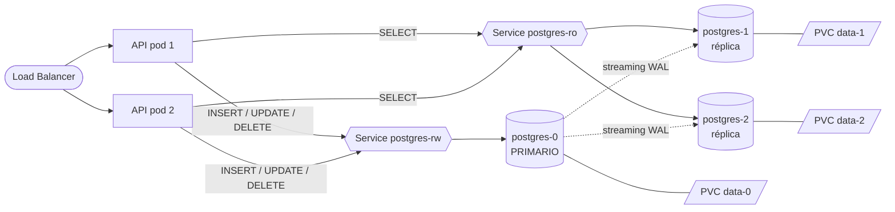
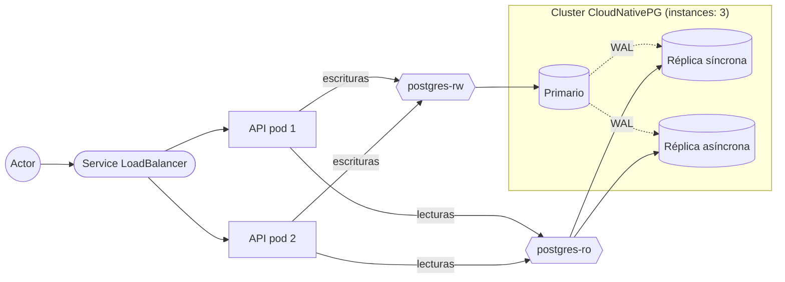

# Punto 4 · Investigación: réplicas de la BBDD y balanceo de carga

> **Pregunta del parcial:** ¿Cómo podríamos tener varias réplicas de la BBDD y cómo podríamos balancear esa carga? *(No implementarlo — 1.5)*

---

## Índice

1. [Respuesta corta](#1-respuesta-corta)
2. [¿Por qué no basta con poner `replicas: 3` en el Deployment de PostgreSQL?](#2-por-qué-no-basta-con-poner-replicas-3-en-el-deployment-de-postgresql)
3. [Paso 1 en Kubernetes: StatefulSet en lugar de Deployment](#3-paso-1-en-kubernetes-statefulset-en-lugar-de-deployment)
4. [Paso 2 en la BBDD: modelos de replicación](#4-paso-2-en-la-bbdd-modelos-de-replicación)
5. [Paso 3: alta disponibilidad y failover automático](#5-paso-3-alta-disponibilidad-y-failover-automático)
6. [Paso 4: ¿cómo se balancea la carga?](#6-paso-4-cómo-se-balancea-la-carga)
7. [Consistencia: el precio de replicar](#7-consistencia-el-precio-de-replicar)
8. [Comparativa de opciones](#8-comparativa-de-opciones)
9. [Propuesta para este proyecto](#9-propuesta-para-este-proyecto)
10. [Referencias](#10-referencias)

---

## 1. Respuesta corta

Replicar una base de datos **no es lo mismo** que replicar una API:

| | API CRUD | Base de datos |
|---|---|---|
| ¿Tiene estado? | No (*stateless*) | Sí (*stateful*) |
| ¿Las réplicas son intercambiables? | Sí, cualquiera responde igual | No: los datos deben estar **sincronizados** entre réplicas |
| Objeto de Kubernetes | `Deployment` | `StatefulSet` (o un **Operator**) |
| ¿Cómo se balancea? | Un `Service` reparte peticiones a cualquier pod | Las **escrituras** van al **primario**; las **lecturas** se reparten entre las **réplicas** |

La receta para PostgreSQL es:

1. Cambiar el `Deployment` por un **`StatefulSet`** con **un volumen por réplica** (`volumeClaimTemplates`).
2. Configurar **replicación primario → réplicas** (*streaming replication* de PostgreSQL): un nodo acepta escrituras y envía su WAL (registro de cambios) a las réplicas, que quedan en modo solo lectura.
3. Añadir **failover automático** (Patroni o un Operator como **CloudNativePG**) para que, si el primario muere, una réplica sea promovida.
4. **Balancear** separando tráfico:
   - Service **`postgres-rw`** → solo al primario (escrituras).
   - Service **`postgres-ro`** → reparte entre las réplicas (lecturas).
   - Opcionalmente un proxy que entiende SQL (**Pgpool-II**, **HAProxy + Patroni**, **PgBouncer**) o la propia aplicación con dos conexiones (*read/write splitting*).



---

## 2. ¿Por qué no basta con poner `replicas: 3` en el Deployment de PostgreSQL?

Si en `k8s/12-postgres-deployment.yaml` cambiamos `replicas: 1` por `replicas: 3`:

1. **Los 3 pods montarían el MISMO PVC.** `ReadWriteOnce` limita el volumen a *un nodo*, no a *un pod*; en un clúster de un nodo los 3 pods lo montarían. Tendríamos 3 procesos PostgreSQL escribiendo sobre la misma carpeta de datos → bloqueos (`postmaster.pid`) o, peor, **corrupción de datos**.
2. **Si cada pod tuviera su propio volumen**, serían **3 bases de datos independientes** con datos distintos. El Service repartiría las conexiones al azar: un `INSERT` caería en un pod y el `SELECT` siguiente en otro donde ese registro no existe.
3. **Los pods de un Deployment no tienen identidad estable**: nombres aleatorios (`postgres-7c9f…`), no hay forma de decir "este es el primario y estos son réplicas".

> 💡 **Conclusión:** Kubernetes pone la infraestructura (pods, volúmenes, red), pero **la replicación es responsabilidad del motor de base de datos**.

---

## 3. Paso 1 en Kubernetes: StatefulSet en lugar de Deployment

Un **StatefulSet** está hecho para aplicaciones con estado:

| Característica | Deployment | StatefulSet |
|---|---|---|
| Nombre de los pods | Aleatorio: `postgres-7c9f8-x2k4l` | Ordinal y estable: `postgres-0`, `postgres-1`, `postgres-2` |
| Volúmenes | Todos comparten el PVC declarado | **Uno por pod** con `volumeClaimTemplates` (`data-postgres-0`, `data-postgres-1`…) |
| DNS | Solo el del Service | Cada pod tiene DNS propio vía un **Service headless**: `postgres-0.postgres-headless.parcial2.svc.cluster.local` |
| Orden de arranque | Todos a la vez | En orden: 0 → 1 → 2 (el 0 puede ser el primario y los demás clonarse de él) |
| Si un pod muere | Lo reemplaza otro con otro nombre | Vuelve **el mismo** nombre con **el mismo** volumen |

El DNS estable es clave: las réplicas saben siempre dónde está el primario (`postgres-0.postgres-headless`) para conectarse y copiar sus cambios.

Ver el esqueleto en [`ejemplos-no-implementados/statefulset-postgres.yaml`](ejemplos-no-implementados/statefulset-postgres.yaml).

---

## 4. Paso 2 en la BBDD: modelos de replicación

### 4.1 Primario–réplicas (líder/seguidores) ⭐ el más usado

- **Un solo nodo acepta escrituras** (primario). Los demás (réplicas o *standby*) reciben una copia y **solo atienden lecturas**.
- En PostgreSQL se llama **streaming replication**: el primario envía su **WAL** (*Write-Ahead Log*, el registro de cada cambio) por la red y las réplicas lo reproducen en tiempo casi real. Con `hot_standby = on` las réplicas aceptan `SELECT`.
- Configuración básica:
  - Primario: `wal_level = replica`, `max_wal_senders`, un usuario con permiso `REPLICATION`.
  - Réplica: se clona con `pg_basebackup` y se arranca con `standby.signal` y `primary_conninfo = 'host=postgres-0.postgres-headless …'`.
  - **Replication slots** para que el primario no borre WAL que una réplica todavía no ha recibido.
- **Asíncrona vs. síncrona:**

| Modo | Cómo funciona | Ventaja | Desventaja |
|---|---|---|---|
| **Asíncrona** (por defecto) | El primario confirma el `COMMIT` sin esperar a las réplicas | Escrituras rápidas | Si el primario muere, se pueden perder las últimas transacciones; las réplicas pueden ir "atrasadas" (*replication lag*) |
| **Síncrona** (`synchronous_standby_names`, `synchronous_commit`) | El `COMMIT` espera a que al menos N réplicas confirmen | Cero pérdida de datos (RPO = 0) | Más latencia; si no hay réplicas disponibles, las escrituras se bloquean |

**Escala:** muy bien las **lecturas** (más réplicas = más `SELECT` por segundo). Las **escrituras** siguen limitadas a un nodo.

### 4.2 Multi-primario (multi-master)

- **Todos los nodos aceptan escrituras** y se sincronizan entre sí.
- Ejemplos: **Galera Cluster** (MariaDB / Percona XtraDB Cluster), **MySQL Group Replication**; en PostgreSQL, soluciones comerciales como EDB Postgres Distributed (BDR) o pgEdge.
- Ventaja: cualquier nodo puede recibir cualquier operación → el balanceo es tan simple como un Service.
- Desventaja: **conflictos** (dos nodos modifican la misma fila al tiempo), más latencia de escritura por la certificación entre nodos.

### 4.3 Particionamiento / sharding

- Se **reparten los datos**: cada nodo guarda un subconjunto (p. ej. productos con id par en un nodo, impares en otro).
- Escala **escrituras** además de lecturas. Ejemplos: **Citus** (extensión de PostgreSQL), **Vitess** (MySQL, el que usa YouTube), sharding de **MongoDB**.
- Normalmente cada shard además tiene sus propias réplicas (4.1).

### 4.4 Bases de datos distribuidas nativas (*Distributed SQL*)

- **CockroachDB**, **YugabyteDB** (compatible con PostgreSQL), **TiDB** (compatible con MySQL).
- Replicación y sharding automáticos usando el algoritmo de **consenso Raft**: cada dato vive en 3+ nodos y se confirma cuando la mayoría lo tiene.
- Todos los nodos aceptan lecturas y escrituras → se despliegan con un StatefulSet y **un Service normal balancea todo**.
- Costo: más complejidad operativa y más latencia por escritura (consenso).

---

## 5. Paso 3: alta disponibilidad y failover automático

PostgreSQL **no promueve una réplica a primario automáticamente**. Si `postgres-0` muere, alguien debe:

1. Detectar la caída.
2. Elegir la réplica más actualizada y **promoverla** (`pg_promote()`).
3. Reconfigurar las demás réplicas para seguir al nuevo primario.
4. Mover el tráfico de escritura al nuevo primario.
5. Evitar **split-brain** (dos primarios a la vez), usando un sistema de consenso.

Herramientas que lo automatizan:

| Herramienta | Qué es | Cómo decide el líder |
|---|---|---|
| **Patroni** | Plantilla de HA para PostgreSQL (Zalando) | Usa un almacén de consenso: etcd, Consul, ZooKeeper **o la propia API de Kubernetes** |
| **CloudNativePG** ⭐ | Operator de Kubernetes (proyecto CNCF) | Su propio *instance manager* + API de Kubernetes |
| **Zalando postgres-operator** | Operator que usa Patroni por dentro | Patroni |
| **Crunchy PGO** | Operator de Crunchy Data, también basado en Patroni | Patroni |
| **repmgr** | Herramienta clásica de replicación y failover | Votación entre nodos |

Un **Operator** es un controlador que extiende Kubernetes con un recurso propio (CRD). En vez de escribir StatefulSets, Services y scripts de failover a mano, declaramos:

```yaml
kind: Cluster          # recurso de CloudNativePG
spec:
  instances: 3         # 1 primario + 2 réplicas
```

y el Operator crea los pods, los volúmenes, la replicación, el failover y **los Services de lectura/escritura**. Ejemplo completo en [`ejemplos-no-implementados/cloudnativepg-cluster.yaml`](ejemplos-no-implementados/cloudnativepg-cluster.yaml).

---

## 6. Paso 4: ¿cómo se balancea la carga?

La regla de oro con primario–réplicas: **escrituras → primario; lecturas → réplicas**.

### 6.1 Con Services de Kubernetes (capa 4, TCP)

Se crean dos Services que seleccionan pods por una etiqueta de **rol** (que pone Patroni o el Operator, y la actualizan en un failover):

```yaml
# Escrituras: solo el primario
kind: Service
metadata: { name: postgres-rw }
spec:
  selector: { app: postgres, role: primary }
---
# Lecturas: se reparten entre las réplicas
kind: Service
metadata: { name: postgres-ro }
spec:
  selector: { app: postgres, role: replica }
```

CloudNativePG crea estos Services automáticamente: `<cluster>-rw`, `<cluster>-ro` y `<cluster>-r` (cualquier instancia).

⚠️ `kube-proxy` balancea **por conexión TCP**, no por consulta. Si la API abre un *pool* de 5 conexiones, esas 5 quedan fijas en ciertas réplicas. Funciona bien con muchas conexiones/clientes, pero no reparte consulta por consulta.

### 6.2 Con un proxy que entiende SQL (capa 7)

| Proxy | Qué hace |
|---|---|
| **Pgpool-II** | *Pooling* de conexiones + **separa automáticamente lecturas y escrituras**: analiza cada consulta, manda `SELECT` a las réplicas (`load_balance_mode = on`, con pesos por nodo) y lo demás al primario. Puede manejar failover. |
| **HAProxy + Patroni** | HAProxy hace *health checks* HTTP a la API REST de Patroni (`/primary` responde 200 solo en el líder, `/replica` solo en réplicas). Expone un puerto para escrituras (p. ej. 5000) y otro para lecturas (5001) con `balance roundrobin`. |
| **PgBouncer** | *Pooler* muy liviano: reduce el costo de abrir conexiones, pero **no** separa lecturas/escrituras por sí solo. Se pone un PgBouncer delante del Service `-rw` y otro delante del `-ro` (CloudNativePG lo ofrece con el recurso `Pooler`). |
| **ProxySQL / MaxScale** | Equivalentes para MySQL/MariaDB (reglas de enrutamiento por consulta). |

Ejemplo de HAProxy con Patroni:

```cfg
listen escrituras
    bind *:5000
    option httpchk GET /primary
    http-check expect status 200
    server postgres-0 postgres-0.postgres-headless:5432 check port 8008
    server postgres-1 postgres-1.postgres-headless:5432 check port 8008
    server postgres-2 postgres-2.postgres-headless:5432 check port 8008

listen lecturas
    bind *:5001
    balance roundrobin
    option httpchk GET /replica
    http-check expect status 200
    server postgres-0 postgres-0.postgres-headless:5432 check port 8008
    server postgres-1 postgres-1.postgres-headless:5432 check port 8008
    server postgres-2 postgres-2.postgres-headless:5432 check port 8008
```

### 6.3 En la aplicación (*read/write splitting*)

La API tendría **dos conexiones**: una al Service `postgres-rw` y otra al `postgres-ro`. Con SQLAlchemy (lo que usa nuestra API):

```python
writer = create_engine("postgresql+psycopg://…@postgres-rw:5432/inventario")
reader = create_engine("postgresql+psycopg://…@postgres-ro:5432/inventario")

def listar_productos():            # GET  → réplica
    with Session(reader) as db: ...

def crear_producto(datos):         # POST → primario
    with Session(writer) as db: ...
```

### 6.4 En el driver: cadenas de conexión con varios hosts

`libpq` (el cliente oficial de PostgreSQL, que usa `psycopg`) acepta varios hosts y elige según el rol:

```text
# Solo se conecta al nodo que acepte escrituras (detecta el primario solo):
postgresql://postgres-0.postgres-headless,postgres-1.postgres-headless,postgres-2.postgres-headless/inventario?target_session_attrs=read-write

# Prefiere réplicas para lecturas y reparte al azar (PostgreSQL 16+):
postgresql://…mismos hosts…/inventario?target_session_attrs=prefer-standby&load_balance_hosts=random
```

---

## 7. Consistencia: el precio de replicar

- **Replication lag:** con replicación asíncrona, una réplica puede ir unos milisegundos (o segundos) atrás. Ejemplo: el usuario crea un producto (va al primario) y la lista que se carga enseguida (va a una réplica) todavía no lo muestra.
  - Soluciones: leer del primario justo después de escribir (*read-your-writes*), usar replicación síncrona con `synchronous_commit = remote_apply`, o monitorear el atraso en `pg_stat_replication` y sacar del balanceo las réplicas muy atrasadas.
- **Teorema CAP:** ante una partición de red, un sistema distribuido debe elegir entre **Consistencia** y **Disponibilidad**. La replicación síncrona prioriza C; la asíncrona, A.
- **PACELC:** incluso sin particiones, hay que elegir entre **Latencia** y **Consistencia** — más réplicas síncronas = más consistencia pero escrituras más lentas.

---

## 8. Comparativa de opciones

| Opción | Escala lecturas | Escala escrituras | Failover | Complejidad | Cuándo usarla |
|---|:-:|:-:|:-:|:-:|---|
| StatefulSet + replicación manual | ✅ | ❌ | Manual | Alta | Para aprender cómo funciona por dentro |
| **CloudNativePG** (Operator) | ✅ | ❌ | ✅ Automático | Baja | **PostgreSQL en Kubernetes en producción** |
| Patroni + HAProxy | ✅ | ❌ | ✅ Automático | Media | PostgreSQL fuera o dentro de K8s, control fino |
| Pgpool-II | ✅ (automático por consulta) | ❌ | ✅ | Media | Cuando la app no puede separar lecturas/escrituras |
| Galera / Group Replication | ✅ | ⚠️ Limitado | ✅ | Media | MySQL/MariaDB multi-primario |
| Citus / Vitess (sharding) | ✅ | ✅ | ✅ | Alta | Volúmenes de datos muy grandes |
| CockroachDB / YugabyteDB | ✅ | ✅ | ✅ (Raft) | Media | Sistemas globales, multi-región |
| BBDD administrada (RDS, Cloud SQL, Azure DB) | ✅ (*read replicas*) | ❌ | ✅ | Muy baja | Cuando se puede usar la nube |

---

## 9. Propuesta para este proyecto

Si tuviéramos que pasar del diagrama del parcial a una BBDD replicada, haríamos:

1. **Instalar el operator CloudNativePG** en el clúster.
2. **Reemplazar** `k8s/10…13` (PV, PVC, Deployment y Service de PostgreSQL) por un recurso `Cluster` con `instances: 3` → 1 primario + 2 réplicas, **cada una con su propio PVC**, con 1 réplica síncrona para no perder datos.
3. **API:** dos conexiones, `postgres-rw` para `POST/PUT/PATCH/DELETE` y `postgres-ro` para `GET` (o un `Pooler` de PgBouncer delante de cada uno).
4. **Failover:** si el primario cae, CloudNativePG promueve una réplica y actualiza el Service `postgres-rw` solo; la API se reconecta (ya usa `pool_pre_ping=True`).



Los manifiestos de ejemplo están en [`docs/ejemplos-no-implementados/`](ejemplos-no-implementados/) y **no se aplican** en el despliegue (el punto pide solo investigar).

---

## 10. Referencias

- Kubernetes — StatefulSets: <https://kubernetes.io/docs/concepts/workloads/controllers/statefulset/>
- Kubernetes — Persistent Volumes: <https://kubernetes.io/docs/concepts/storage/persistent-volumes/>
- PostgreSQL — High Availability, Load Balancing, and Replication: <https://www.postgresql.org/docs/16/high-availability.html>
- PostgreSQL — libpq, parámetros `target_session_attrs` y `load_balance_hosts`: <https://www.postgresql.org/docs/16/libpq-connect.html>
- CloudNativePG — Arquitectura y Services rw/ro/r: <https://cloudnative-pg.io/documentation/current/architecture/>
- Patroni: <https://patroni.readthedocs.io/>
- Pgpool-II — Load balancing: <https://www.pgpool.net/docs/latest/en/html/runtime-config-load-balancing.html>
- PgBouncer: <https://www.pgbouncer.org/>
- Kleppmann, M. *Designing Data-Intensive Applications*, cap. 5 (Replication) y 6 (Partitioning). O'Reilly.
